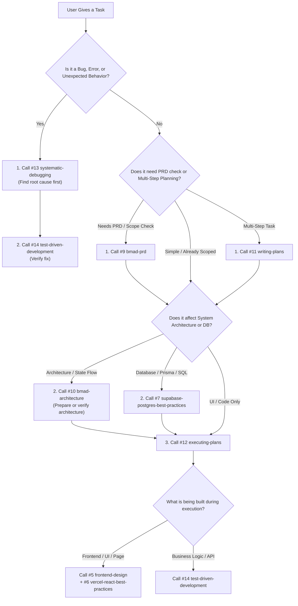

# Smart Skill Router (`smart-skill-router`)

> **Purpose:** When the user gives a task, do NOT guess or jump straight into writing unstructured code. First classify what the task needs, then **dynamically load (`read_file`) and execute the required skills in the exact sequence below**.

---

## 1. The 9 Managed Skills Directory (Direct Lookup)

| # | Skill ID | Skill File Path | Core Responsibility |
| :- | :--- | :--- | :--- |
| **5** | `frontend-design` | `d:\Antigravity workspace\Fulfillio\.agents\skills\frontend-design\SKILL.md` | Clean, production-grade UI/UX design following brand colors & minimal clutter |
| **6** | `vercel-react-best-practices` | `d:\Antigravity workspace\Fulfillio\.agents\skills\react-best-practices\SKILL.md` | React & Next.js App Router performance, rendering, and bundle optimization |
| **7** | `supabase-postgres-best-practices` | `d:\Antigravity workspace\Fulfillio\.agents\skills\supabase-postgres-best-practices\SKILL.md` | PostgreSQL schema design, composite indexes, migrations, and query tuning |
| **9** | `bmad-prd` | `d:\Antigravity workspace\Fulfillio\.agents\skills\bmad-prd\SKILL.md` | Creating, reading, updating, or validating Product Requirements (PRD) |
| **10** | `bmad-architecture` | `d:\Antigravity workspace\Fulfillio\.agents\skills\bmad-architecture\SKILL.md` | Designing or validating technical architecture, state machines, and module boundaries |
| **11** | `writing-plans` | `d:\Antigravity workspace\Fulfillio\.agents\skills\superpowers-writing-plans\SKILL.md` | Writing step-by-step implementation plans before touching code |
| **12** | `executing-plans` | `d:\Antigravity workspace\Fulfillio\.agents\skills\superpowers-executing-plans\SKILL.md` | Executing an implementation plan step-by-step with verification checkpoints |
| **13** | `systematic-debugging` | `d:\Antigravity workspace\Fulfillio\.agents\skills\superpowers-systematic-debugging\SKILL.md` | Finding the exact root cause of any bug, mismatch, or failure before fixing |
| **14** | `test-driven-development` | `d:\Antigravity workspace\Fulfillio\.agents\skills\superpowers-test-driven-development\SKILL.md` | Writing and verifying tests for business logic, calculations, and bugfixes |

---

## 2. Dynamic Decision Tree (How to Route Any Task)

Whenever you receive a task from the user, evaluate these **5 Gates** in order and activate (`read_file`) only the skills that apply to the task:

---

## 3. Step-by-Step Execution Protocol

### Step 1: Announce Active Skill Chain
At the start of working on a user task, briefly identify which skills from the 9-skill matrix are needed for this specific request:
> **Active Skill Route:** `[Skill A] -> [Skill B] -> [Skill C]`

### Step 2: Execute Phase-by-Phase

#### Phase A — Requirements & Planning (`#9 bmad-prd` & `#11 writing-plans`)
- **When to trigger `#9 bmad-prd`:**
  - The user asks to build a new module/workflow, or asks to align code with existing PRD files (e.g., `mvp-goals-and-progress/*.md`).
  - **Action:** Read `d:\Antigravity workspace\Fulfillio\.agents\skills\bmad-prd\SKILL.md`, validate scope vs. anti-scope, and ensure no unnecessary options are added.
- **When to trigger `#11 writing-plans`:**
  - The task involves modifying multiple files or building a multi-step feature.
  - **Action:** Read `d:\Antigravity workspace\Fulfillio\.agents\skills\superpowers-writing-plans\SKILL.md` and construct a clear, bite-sized execution plan before editing code.

#### Phase B — Architecture & Database Check (`#10 bmad-architecture` & `#7 supabase-postgres-best-practices`)
- **When to trigger `#10 bmad-architecture`:**
  - The task changes order pipelines, state machines (`PENDING -> PICK -> PACK -> DISPATCH`), module boundaries, or API contracts.
  - **Action:** Read `d:\Antigravity workspace\Fulfillio\.agents\skills\bmad-architecture\SKILL.md` and verify that the architecture is consistent and clean.
- **When to trigger `#7 supabase-postgres-best-practices`:**
  - The task touches `schema.prisma`, SQL queries, indexes, migrations, or tenant isolation (`merchantId`).
  - **Action:** Read `d:\Antigravity workspace\Fulfillio\.agents\skills\supabase-postgres-best-practices\SKILL.md` before modifying any database schema or query.

#### Phase C — Implementation, UI & TDD (`#12 executing-plans`, `#5 frontend-design`, `#6 vercel-react-best-practices`, `#14 test-driven-development`)
- **When to trigger `#12 executing-plans`:**
  - Once the plan and architecture are verified, read `d:\Antigravity workspace\Fulfillio\.agents\skills\superpowers-executing-plans\SKILL.md` to execute each step systematically.
- **When to trigger `#5 frontend-design` + `#6 vercel-react-best-practices`:**
  - Whenever creating or updating any React/Next.js page, dashboard, table, modal, or print layout.
  - **Action:** Read `d:\Antigravity workspace\Fulfillio\.agents\skills\frontend-design\SKILL.md` (to keep the UI clean, clutter-free, and strictly aligned with Fulfillio's Emerald + Slate brand palette) and `d:\Antigravity workspace\Fulfillio\.agents\skills\react-best-practices\SKILL.md` (to keep Next.js rendering and bundles fast).
- **When to trigger `#14 test-driven-development`:**
  - Whenever implementing or changing calculations, stock reservation/restoration logic, billing rules, or API services.
  - **Action:** Read `d:\Antigravity workspace\Fulfillio\.agents\skills\superpowers-test-driven-development\SKILL.md` and verify behavior with tests before marking complete.

#### Phase D — Debugging & Root-Cause Fixing (`#13 systematic-debugging`)
- **When to trigger `#13 systematic-debugging`:**
  - Whenever the user reports a bug (e.g., "কেন পুরো পেজ প্রিন্ট হয়ে যাচ্ছে?", "হিসাব কেন কম দেখাচ্ছে?", build error, or runtime bug).
  - **Action:** Read `d:\Antigravity workspace\Fulfillio\.agents\skills\superpowers-systematic-debugging\SKILL.md` FIRST. Trace the exact root cause before making any code edit.

---

## 4. Common Task Routing Recipes

| User Request Type | Automatic Skill Chain Triggered |
| :--- | :--- |
| **New Module / Full Pipeline** (e.g., *"রিটার্ন বা কুরিয়ার মডিউল PRD অনুযায়ী রেডি করো"*) | `#9 bmad-prd` $\rightarrow$ `#10 bmad-architecture` $\rightarrow$ `#11 writing-plans` $\rightarrow$ `#12 executing-plans` + `#5 frontend-design` + `#6 vercel-react-best-practices` |
| **UI Redesign / Clean-up** (e.g., *"ড্যাশবোর্ড ক্লিন করো, অযথা অপশন কমাও"*) | `#11 writing-plans` $\rightarrow$ `#5 frontend-design` + `#6 vercel-react-best-practices` $\rightarrow$ `#12 executing-plans` |
| **Database + Backend API** (e.g., *"নতুন ইনভেন্টরি বা বিলিং টেবিল ও API যোগ করো"*) | `#10 bmad-architecture` $\rightarrow$ `#7 supabase-postgres-best-practices` $\rightarrow$ `#14 test-driven-development` $\rightarrow$ `#12 executing-plans` |
| **Bug / Calculation / Print Issue** (e.g., *"মেমো প্রিন্ট দিলে পুরো পেজ প্রিন্ট হয় কেন?"*) | `#13 systematic-debugging` $\rightarrow$ `#11 writing-plans` $\rightarrow$ `#12 executing-plans` + `#14 test-driven-development` |

---

## 5. Mandatory Architecture & Code Quality Standards (SRP & Reusability)

EVERY code generation, refactoring, or feature implementation across Frontend, Backend, and Database MUST strictly obey these Single Responsibility Principle (SRP) and Reusability rules:

### A. Frontend Architecture Standards (Next.js 15 & React)
1. **File Size Hard Ceiling (Max 300–400 Lines):**
   - **NEVER** write monster single-file components (1,000+ lines).
   - If a component exceeds 350 lines, immediately decompose it into dedicated sub-components.
2. **Feature-Sliced Directory Structure:**
   Every feature in `apps/web/src/features/<feature-name>/` MUST follow this structure:
   - `types.ts`: All TypeScript interfaces, filter types, enums, and view models.
   - `mockData.ts` (or `api.ts`): Mock seed data, storage keys (`localStorage`), pure data manipulation/resizing helpers.
   - `components/`: Specific sub-components (KPI cards, tables, drawer sidebars, modal dialogues, tab views).
   - `components/<sub-tab>/`: If a drawer or dashboard has sub-tabs, each tab lives in its own file.
   - `<FeatureManager>.tsx`: A lean orchestrator (< 200 lines) holding top-level state, URL params, and rendering the sub-components.
3. **Reusable Atomic UI Primitives (`apps/web/src/components/ui/`):**
   - Do NOT duplicate badges, tabs, stat cards, or table headers across different screens.
   - Extract generic widgets into `components/ui/` (e.g., `StatusBadge`, `TabsNav`, `StatCard`, `Button`, `Badge`, `Card`, `SearchInput`).
4. **App Router Sub-Routing:**
   - Instead of huge tab switches on a single page, decompose modules into clean Next.js sub-routes (e.g., `/admin/products`, `/admin/orders`, `/admin/merchants`, `/admin/returns`) with shared layouts.

### B. Backend Architecture Standards (NestJS 11 Modular Monolith)
1. **Strict 3-Tier Layer Separation:**
   - `*.controller.ts`: Handles HTTP routing, Swagger docs, validation pipes, and `@UseGuards(JwtAuthGuard, RolesGuard)`. NO business logic.
   - `*.service.ts`: Handles business validation, calculations, state machine transitions, and orchestrating repositories.
   - `*.repository.ts` / Prisma Queries: Pure data access with mandatory tenant isolation filters (`where: { merchantId }`).
2. **Data Contracts & DTOs:**
   - DTOs validated via `class-validator` and `class-transformer`.
   - Shared enums and interfaces live in `packages/contracts/src/index.ts` so both frontend and backend share exact types.
3. **Asynchronous Jobs & Queues:**
   - Producers stay inside the feature domain service (`queue.service.ts`).
   - Consumers/Processors live inside `apps/worker/src/`. Never block HTTP endpoints with PDF generation or external webhooks.

### C. Database Architecture Standards (PostgreSQL 16 & Prisma)
1. **Tenant Isolation:**
   - Every merchant-owned table MUST include `merchantId String`.
   - Composite indexes MUST be declared for common query patterns: `@@index([merchantId, status])`, `@@index([merchantId, createdAt])`.
2. **Concurrency & Inventory Safety:**
   - Stock allocations and reservations MUST use atomic operations or database transactions (`FOR UPDATE` locking / `decrement`) to prevent double-selling.
3. **Schema Normalization:**
   - Do not dump structured relational entities into unindexed JSONB blobs unless specifically required (e.g., custom memo invoice visual templates).

