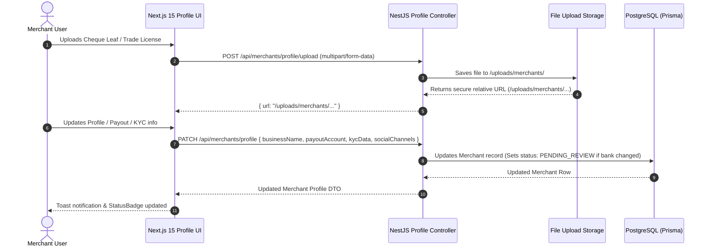

# Architecture Spine: My Store Profile Module

> **Domain:** Merchant Store Profile, KYC Verification & Payout Governance  
> **Status:** APPROVED & BINDING  
> **Author:** Antigravity AI & Architecture Team  

---

## 1. Paradigm & Invariants

- **Paradigm:** Modular Domain Slice (Pragmatic Monolith).  
- **Tenant Isolation:** Every operation strictly binds to `req.user.merchantId`.  
- **Pillars of Profile:**
  1. **Store Identity & Contact:** Store Name, Owner Name, Contact Phone, Email, Pickup Address, Store Logo.
  2. **Payout & Disbursement:** Bank details (Provider, Account Holder, Account Number, Branch, Routing) + MFS (bKash/Nagad Merchant) + Cheque Leaf Document.
  3. **Business Verification & KYC:** Trade License Number & Document URL, NID Number, Verification Status (`PENDING | APPROVED | SUSPENDED`).
  4. **Social & Sales Channels:** Multi-platform links (Facebook, Instagram, TikTok, WhatsApp, YouTube).
- **Security Lock Invariant:** Any mutation of Payout Bank Details or Cheque Leaf document locks the payout status to `PENDING_REVIEW` until approved by Super Admin.
- **File Decomposition Invariant:** No single component shall exceed 200–250 lines. Large monoliths are strictly prohibited.

---

## 2. Full-Stack Data & Control Flow



---

## 3. Database Schema Specification (Hybrid PostgreSQL)

The `Merchant` model in `apps/api/prisma/schema.prisma`:

```prisma
model Merchant {
  id                String         @id @default(uuid())
  merchantCode      String         @unique @default("MC-101")
  businessName      String
  ownerName         String?        @default("Store Owner")
  email             String         @unique
  phone             String?
  location          String?        @default("Dhaka, Bangladesh")
  logoUrl           String?
  status            MerchantStatus @default(PENDING)
  
  // Strongly-typed JSONB structures
  payoutAccount     Json?          @db.JsonB
  kycData           Json?          @db.JsonB
  socialChannels    Json?          @db.JsonB
  
  baseHandlingFee   Decimal        @default(50.00) @db.Decimal(10, 2)
  monthlyStorageFee Decimal        @default(2500.00) @db.Decimal(10, 2)
  apiKeyHash        String?
  webhookUrl        String?
  webhookSecret     String?
  createdAt         DateTime       @default(now())
  updatedAt         DateTime       @updatedAt
  
  // Relations
  users             User[]
  products          Product[]
  orders            Order[]
  memoTemplates     MemoTemplate[]
  settlements       Settlement[]
  inboundShipments  InboundShipment[]
  auditLogs         InventoryAuditLog[]
  webhookDeliveryLogs WebhookDeliveryLog[]

  @@index([merchantCode])
  @@index([status])
  @@map("merchants")
}
```

### JSONB Interfaces

```typescript
export interface PayoutAccountData {
  provider: string;           // e.g. 'BRAC Bank PLC', 'City Bank', 'bKash Merchant'
  accountHolder: string;
  accountNumber: string;
  branchName: string;
  routingNumber: string;
  frequency: string;          // 'Weekly' | 'Bi-Weekly' | 'Monthly'
  status: 'VERIFIED' | 'PENDING_REVIEW' | 'REJECTED';
  chequeLeafUrl?: string;
  rejectionReason?: string;
  mfsNumber?: string;
}

export interface KycData {
  tradeLicenseNo?: string;
  tradeLicenseDocUrl?: string;
  nidNumber?: string;
  nidDocUrl?: string;
  verificationStatus: 'UNVERIFIED' | 'PENDING_REVIEW' | 'VERIFIED' | 'REJECTED';
  verifiedAt?: string;
  notes?: string;
}

export interface SocialChannelData {
  id: string;
  platform: 'Facebook' | 'Instagram' | 'TikTok' | 'YouTube' | 'WhatsApp';
  url: string;
}
```

---

## 4. Backend Architecture (`apps/api/src/modules/merchants/`)

1. **`merchant.controller.ts`:**
   - `GET /merchants/profile`: Returns full profile, payout status, and KYC data.
   - `PATCH /merchants/profile`: Updates profile, payout info (triggers `PENDING_REVIEW` if bank changes), KYC, and social channels.
   - `POST /merchants/profile/upload`: Secure file upload endpoint with MIME validation (`image/png`, `image/jpeg`, `image/webp`, `application/pdf`) and 5MB size limit.
2. **`merchant.service.ts`:**
   - Enforces verification state transitions.
   - Emits audit log or notifications on bank detail changes.
3. **`merchant.repository.ts`:**
   - Executes atomic Prisma updates.

---

## 5. Frontend Feature Directory Structure (`apps/web/src/features/merchant-portal/profile/`)

```
apps/web/src/features/merchant-portal/profile/
├── index.ts                         # Public feature exports
├── types.ts                         # Profile & KYC interfaces
├── MerchantProfileTab.tsx           # Lean orchestrator (< 150 lines)
├── components/
│   ├── StoreIdentityCard.tsx        # Card 1: Logo, Store Name, Contact, Pickup Address (< 150 lines)
│   ├── PayoutAccountCard.tsx        # Card 2: Bank details, MFS, Cheque preview (< 180 lines)
│   ├── KycVerificationCard.tsx      # Card 3: Trade license, NID status & upload trigger (< 150 lines)
│   └── SocialChannelsCard.tsx       # Card 4: Social channels list & action pills (< 140 lines)
└── modals/
    ├── EditProfileModal.tsx         # Modal: Store Info & Pickup location
    ├── ManagePayoutModal.tsx        # Modal: Bank Account & Cheque Leaf upload
    ├── KycUploadModal.tsx           # Modal: Trade License & NID submission
    └── SocialChannelModal.tsx       # Modal: Add/Edit Social media URLs
```

---

## 6. Shared Reusable UI Primitives (`apps/web/src/components/ui/`)

These 3 components are extracted for platform-wide reusability:
1. **`VerificationStatusBadge`** (`apps/web/src/components/ui/VerificationStatusBadge.tsx`):
   - Renders `VERIFIED`, `PENDING_REVIEW`, `REJECTED`, `UNVERIFIED` with brand color pills and icons.
2. **`DocumentUploadDropzone`** (`apps/web/src/components/ui/DocumentUploadDropzone.tsx`):
   - Drag-and-drop file upload with preview, file size check, and loading state.
3. **`DocumentViewerModal`** (`apps/web/src/components/ui/DocumentViewerModal.tsx`):
   - Zoomable, lightbox-style modal to view cheques, invoices, or trade license documents.
