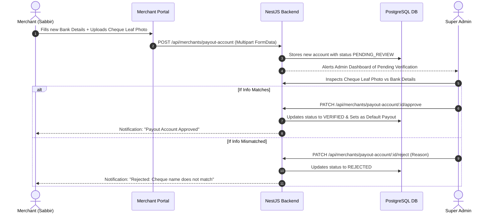

# Wireframe Spec: Module 02 — Merchant Profile & Payout Account

> **ফাইল লোকেশন:** `mvp-goals-and-progress/WIREFRAME_MODULE_02_MERCHANT_PROFILE.md`  
> **ডিজাইন রেফারেন্স:** ইউজার আপলোডকৃত ডার্ক মডার্ন UI (`media_1792788403783_36cb9d97.png`) এর শতভাগ বাস্তবায়ন।  
> **স্কিল ও মডেল রুল:**  
> • আর্কিটেকচার ও ডায়াগ্রামের জন্য: **`fulfillio-architect` (Claude 3.5 Sonnet / Gemini Pro / Argon)**  
> • দ্রুত কোডিং ও স্ক্রিন বানানোর জন্য: **`fulfillio-builder` (Gemini Flash / Medium)**  

---

## 🧭 ১. নেভিগেশন ও এন্ট্রি পয়েন্ট (Top-Right Profile Menu)

মার্চেন্ট পোর্টালে স্ক্রিনের উপরে ডানপাশে থাকা ইউজার অ্যাভাটার/প্রোফাইলে ক্লিক করলে এই ড্রপডাউনটি ওপেন হবে:

```
+-----------------------------------------------------------------------------------------+
| [F] Fulfillio WMS     Search orders, SKUs...                 (🔔)  [ MC-101 | Sabbir A. ▾] |
+-----------------------------------------------------------------------------------------+
                                                                     |
                                                                     v [DROPDOWN MENU]
                                            +---------------------------------------------+
                                            |  Sabbir's Store                             |
                                            |  sabbir@example.com                         |
                                            |  Merchant ID: [ MC-101 ] (System Locked)    |
                                            +---------------------------------------------+
                                            |  👤 My Profile & Account Settings           |
                                            |  💳 Payout & Settlement Setup               |
                                            |  🔑 API Keys & Webhooks                     |
                                            +---------------------------------------------+
                                            |  🚪 Log Out                                 |
                                            +---------------------------------------------+
```

---

## 🖥️ ২. মার্চেন্ট প্রোফাইল স্ক্রিন লেআউট (ASCII Wireframe — Reference Image Match)

আপলোডকৃত ইমেজের ডার্ক SaaS গ্রিড লেআউট অনুযায়ী নিখুঁত স্ক্রিন ডিজাইন:

```
+---------------------------------------------------------------------------------------------------------------+
|  (👤) Profile                                                                                  [ ✏️ Edit profile ] |
|      Manage your seller identity, payout info, and social channels.                                           |
|                                                                                                               |
|  +---------------------------------------------------------------------------------------------------------+  |
|  |  +-------+   Sabbir Ahmed  [ 🟢 VERIFIED MERCHANT ]                                                     |  |
|  |  |       |   Sabbir's Store                                                                             |  |
|  |  | [IMG] |   ✉️ sabbir@example.com   📍 Dhaka, Bangladesh   🆔 Merchant ID: MC-101                       |  |
|  |  +-------+                                                                                              |  |
|  +---------------------------------------------------------------------------------------------------------+  |
|                                                                                                               |
|  [ LEFT COLUMN: 60% WIDTH ]                                  [ RIGHT COLUMN: 40% WIDTH ]                      |
|  +--------------------------------------------------------+  +---------------------------------------------+  |
|  |  Personal information                              (👤)|  |  (🛡️) Account Overview                      |  |
|  |  Your contact details.                                 |  |      Merchant ID: MC-101                    |  |
|  |                                                        |  |                                             |  |
|  |  Full name                      Phone number           |  |  Account Status                      Active |  |
|  |  [ Sabbir Ahmed              ]  [ 01712 345678       ] |  |  Default Payout               Bank Transfer |  |
|  |                                                        |  |  Payout Schedule                    Weekly |  |
|  |  Email address                  Location               |  |  Connected Channels               3 Active  |  |
|  |  [ sabbir@example.com        ]  [ Dhaka, Bangladesh  ] |  +---------------------------------------------+  |
|  +--------------------------------------------------------+                                                   |
|                                                              +---------------------------------------------+  |
|  +--------------------------------------------------------+  |  Social Media Channels                      |  |
|  |  (💳) Default Payout Account          Manage Payouts > |  |  Connected platforms for promotions.        |  |
|  |      Account selected to receive seller earnings.      |  |                                             |  |
|  |                                                        |  |  [ + Add Channel ]                          |  |
|  |  +--------------------------------------------------+  |  |                                             |  |
|  |  | [🏦] BANK  [ Default ]                           |  |  |  [f] Facebook               [✏️] [🗑️]      |  |
|  |  |     1501204892019001            Frequency: Weekly |  |  |      https://facebook.com/sabbirstore     |  |
|  |  |     A/C Holder: Sabbir Ahmed (BRAC Bank PLC)     |  |  |                                             |  |
|  |  |     Routing: 060271829 • Branch: Banani          |  |  |  [📷] Instagram              [✏️] [🗑️]      |  |
|  |  |     Cheque Leaf: [ 🟢 Verified Leaf ] [View Pic] |  |  |      https://instagram.com/sabbirstore    |  |
|  |  +--------------------------------------------------+  |  |                                             |  |
|  +--------------------------------------------------------+  |  [🎵] TikTok                 [✏️] [🗑️]      |  |
|                                                              |      https://tiktok.com/@sabbirstore       |  |
|                                                              +---------------------------------------------+  |
+---------------------------------------------------------------------------------------------------------------+
```

---

## 🔍 ৩. পে-আউট আপডেট ও চেক পাতার ছবি আপলোড মোডাল (Manage Payouts Modal)

মার্চেন্ট যখন `Manage Payouts >` এ ক্লিক করে নতুন ব্যাংক অ্যাকাউন্ট অ্যাড বা পরিবর্তন করতে চাইবে:

```
+-----------------------------------------------------------------------------------------+
|  Update COD Payout Account                                                          [X] |
+-----------------------------------------------------------------------------------------+
|  ⚠️ Security Notice: Changing payout destination requires Admin verification before     |
|     future COD funds are routed to the new account.                                     |
|                                                                                         |
|  Select Provider / Bank:                                                                |
|  [ BRAC Bank PLC                                                                     ▾] |
|                                                                                         |
|  Account Holder Name (Must match cheque leaf):                                          |
|  [ Sabbir Ahmed                                                                       ] |
|                                                                                         |
|  Account Number:                             Branch Name & Routing Number:              |
|  [ 1501204892019001                        ] [ Banani Branch (Routing: 060271829)     ] |
|                                                                                         |
|  Upload Cheque Leaf / Account Document Photo:                                           |
|  +-----------------------------------------------------------------------------------+  |
|  |  📁 Drag & drop cheque photo here, or browse (JPG, PNG, PDF max 5MB)              |  |
|  |  [ Current: cheque_leaf_verified_2026.png  (1.4 MB) ]                             |  |
|  +-----------------------------------------------------------------------------------+  |
|                                                                                         |
|  Payout Frequency: [ Weekly (Every Friday) ▾ ]                                          |
|                                                                                         |
|                                           [ Cancel ]  [ Submit for Admin Verification ] |
+-----------------------------------------------------------------------------------------+
```

---

## 🛡️ ৪. অ্যাডমিন রিভিউ ও চেক লিফ ভেরিফিকেশন মোডাল (Admin View)

```
+-----------------------------------------------------------------------------------------+
|  Review Merchant Payout Account Request                                             [X] |
+-----------------------------------------------------------------------------------------+
|  Merchant: Sabbir Ahmed [ MC-101 ] — Sabbir's Store                                     |
|  Submitted on: 24 Oct 2026, 02:45 AM                                                    |
|                                                                                         |
|  NEW REQUESTED ACCOUNT:                                                                 |
|  - Bank: BRAC Bank PLC                                                                  |
|  - Holder: Sabbir Ahmed                                                                 |
|  - A/C No: 1501204892019001                                                            |
|  - Branch: Banani (Routing: 060271829)                                                  |
|                                                                                         |
|  VERIFICATION ATTACHMENT (CHEQUE LEAF PHOTO):                                           |
|  +-----------------------------------------------------------------------------------+  |
|  |                                                                                   |  |
|  |                  [ CHEQUE BOOK LEAF HIGH-RES IMAGE VIEWER ]                       |  |
|  |                  Account Holder: Sabbir Ahmed                                     |  |
|  |                  A/C: 1501204892019001                                            |  |
|  |                                                                                   |  |
|  +-----------------------------------------------------------------------------------+  |
|                                                                                         |
|  Verification Note (Optional):                                                          |
|  [ Account name and number match cheque leaf photo perfectly.                        ]  |
|                                                                                         |
|                                       [ Reject with Reason ]  [ Approve Payout Account ]|
+-----------------------------------------------------------------------------------------+
```

---

## 🔄 ৫. স্টেট মেশিন ও ডায়াগ্রাম (Payout Account Lifecycle)



---

*এই ওয়্যারফ্রেমটি এখন প্রস্তুত। পরবর্তী ধাপে `fulfillio-builder` স্কিল ব্যবহার করে সরাসরি কোড বাস্তবায়ন শুরু করা যাবে।*
